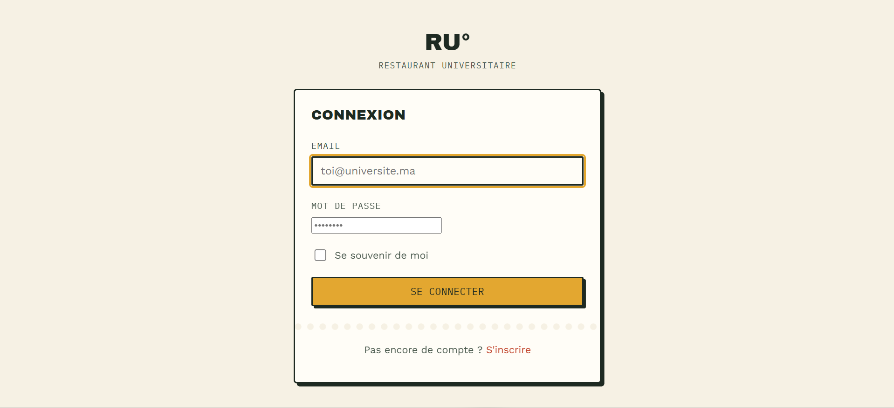
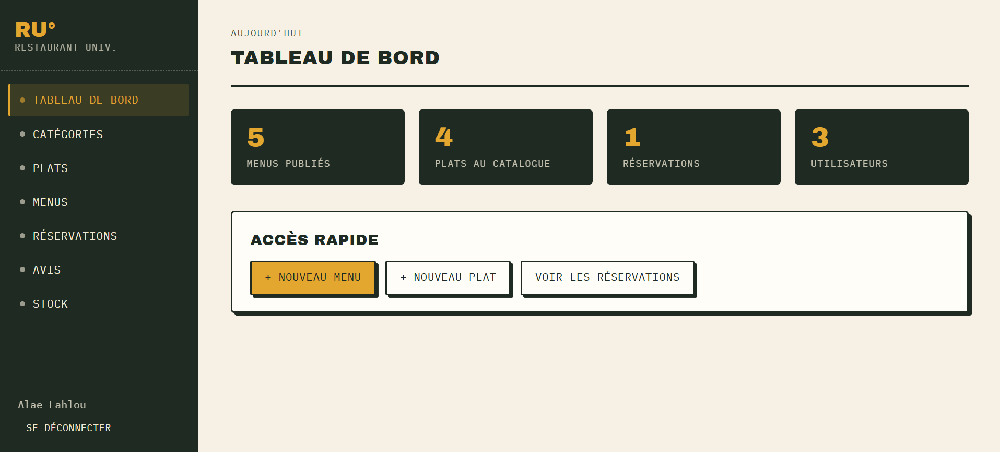
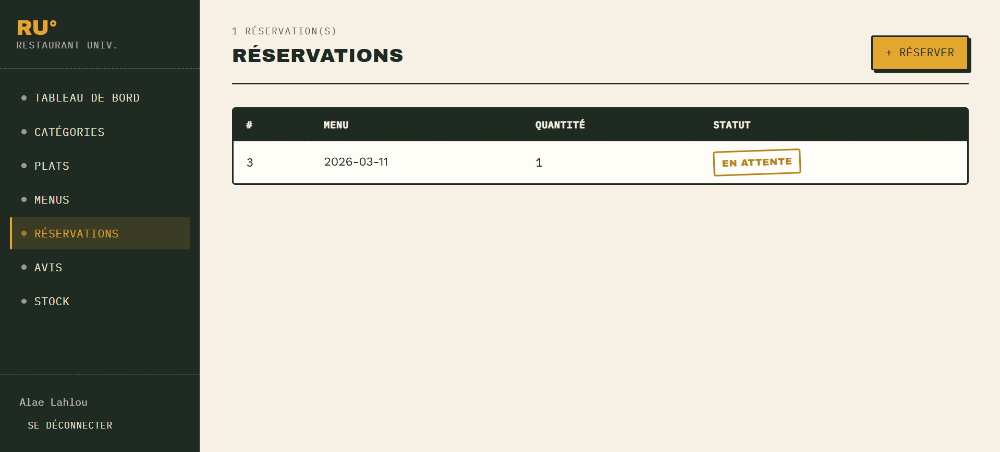
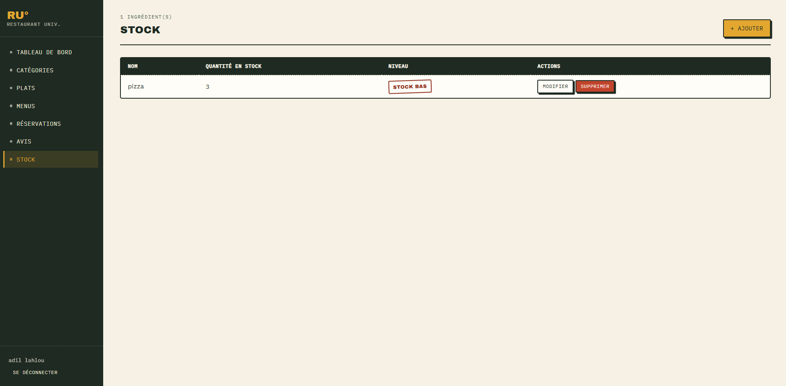
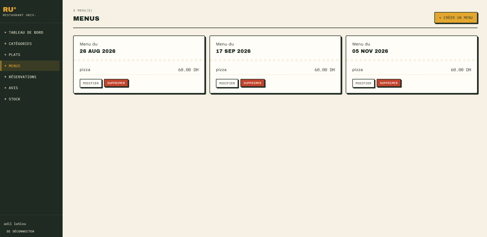
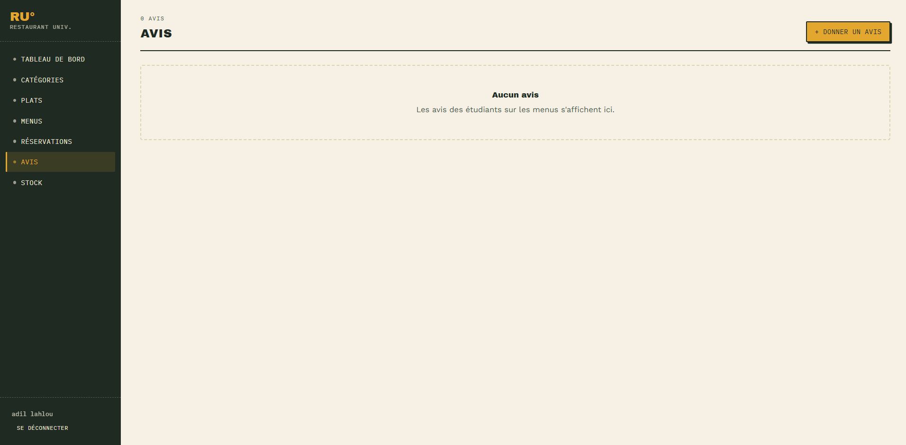
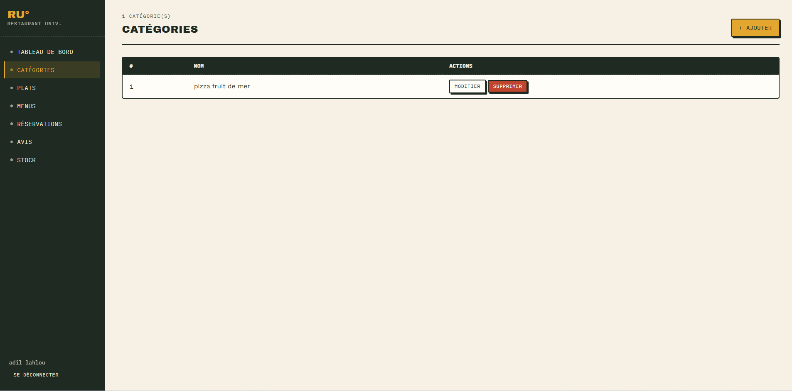
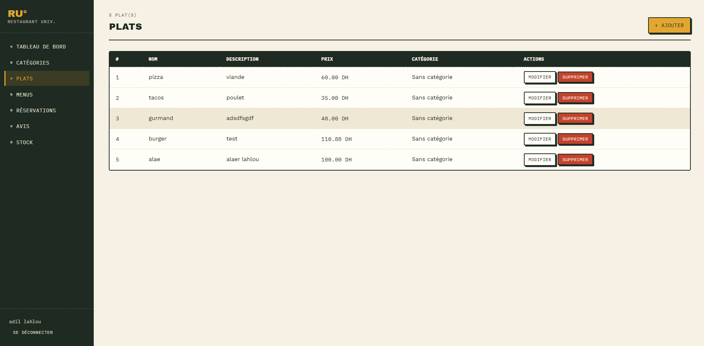

# Gestion de Restaurant Universitaire

Application web de gestion de restaurant universitaire développée avec **Laravel**. Elle permet de gérer les étudiants, les menus, les avis, les réservations de repas et les paiements.

## Fonctionnalités

- Authentification et gestion des utilisateurs
- Gestion des étudiants
- Gestion des menus et des repas
- Réservation de repas
- Gestion des paiements

## Technologies utilisées

- **Backend** : Laravel
- **Frontend** : HTML5, CSS3, Bootstrap, JavaScript
- **Base de données** : MySQL

## Installation

1. Cloner le dépôt :
```bash
git clone https://github.com/alaelahlou/gestion-restaurant-universitaire.git
cd gestion-restaurant-universitaire
```

2. Installer les dépendances :
```bash
composer install
npm install
```

3. Configurer l'environnement :
```bash
cp .env.example .env
php artisan key:generate
```
Puis modifier dans le fichier `.env` les informations de la base de données (`DB_DATABASE`, `DB_USERNAME`, `DB_PASSWORD`).

4. Créer les tables de la base de données :
```bash
php artisan migrate
```

5. Lancer le projet :
```bash
npm run dev
php artisan serve
```
L'application sera accessible sur `http://127.0.0.1:8000`.

## Captures d'écran

Voici quelques interfaces de l'application :

### Interface 1


### Interface 2


### Interface 3


### Interface 4


### Interface 5


### Interface 6


### Interface 7


### Interface 8


## Auteur

**Alae Lahlou**  
GitHub : [@alaelahlou](https://github.com/alaelahlou)
